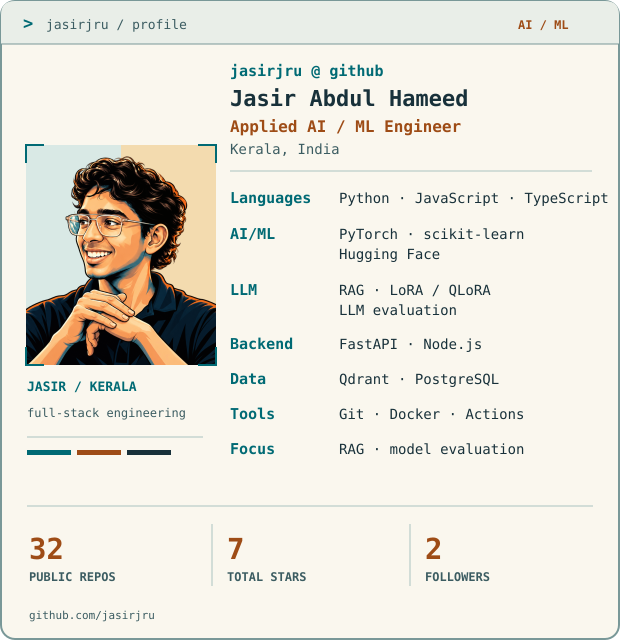

<picture>
  <source media="(prefers-color-scheme: dark)" srcset="./dark_mode.svg">
  
</picture>

### Applied AI engineer: I build LLM applications and ML services, then measure whether they work.

B.Tech Computer Science, 2026 · Kerala, India · open to entry-level Applied AI, GenAI and ML engineering roles.

[Portfolio](https://jasirjru-portfolio.vercel.app) · [LinkedIn](https://www.linkedin.com/in/jasirjru) · [Hugging Face](https://huggingface.co/jasirjru) · [Email](mailto:jasirlvl@gmail.com) · [Resume](https://jasirjru-portfolio.vercel.app/resume.pdf)

---

### Featured work

| Project | What it is | Evidence |
|---|---|---|
| **[Jruva](https://www.jruva.in)** [benchmark](https://github.com/jasirjru/jruva-retrieval-eval) | Public-beta document-QA assistant. FastAPI + Next.js, hybrid retrieval (BGE embeddings in Qdrant, BM25, reciprocal rank fusion) and multi-provider LLM failover. | Reproducible benchmark on 100 queries: dense MRR **0.91** vs BM25 **0.81**. Fusion did not beat dense overall and halved Hit@1 on ambiguous queries. |
| **[CustomerIQ](https://github.com/jasirjru/CustomerIQ)** [live demo](https://customeriq-qd2v.onrender.com) | Churn-scoring inference API. Strict Pydantic contracts, SHA-256 model-artifact verification and a model card. | CI runs 124 pytest tests, Playwright browser and axe accessibility checks, and a container vulnerability scan. Scores are documented as uncalibrated. |
| **[DomainTune](https://github.com/jasirjru/DomainTune#results)** [model](https://huggingface.co/jasirjru/DomainTune-Qwen2.5-1.5B-Triage) | QLoRA fine-tune of Qwen2.5-1.5B that turns support tickets into five-field JSON triage. | Valid JSON **22.5% → 92.5%** on a 40-example gold set; exact match still 0%. Diagnosed a missing stop token and majority-class collapse. |
| **[NASA Space Apps 2024](https://www.spaceappschallenge.org/2024/find-a-team/darknova/)** [site](https://github.com/jasirjru/dark_nova) | Website developer in six-member Team DarkNova (Galactic Games challenge). | Global Nominee and People's Choice. |

### How I work

- **Evidence first.** Every result above links to the data, scripts or tests behind it.
- **Report what fails.** Negative results (fusion not helping, a fine-tune that never stops) are documented, with the next fix.
- **Guardrails before features.** Input validation, artifact checks, CI, accessibility and security scans.

### Next

- Retrain DomainTune with the end-of-sequence fix and rebalanced labels, then rerun the gold-set evaluation.
- Extend the Jruva benchmark with held-out queries that were not used for tuning.

### Stack

**AI and LLMs:** Python · PyTorch · Hugging Face Transformers, PEFT, TRL · QLoRA · scikit-learn · RAG · Qdrant · BM25 · retrieval and LLM evaluation 
**Backend:** FastAPI · Pydantic · PostgreSQL · Alembic · REST APIs 
**Frontend:** TypeScript · Next.js · React 
**Engineering:** Git · GitHub Actions · Docker · pytest · Playwright

Profile card regenerated daily by GitHub Actions from <a href="generate_profile.py">generate_profile.py</a>.
